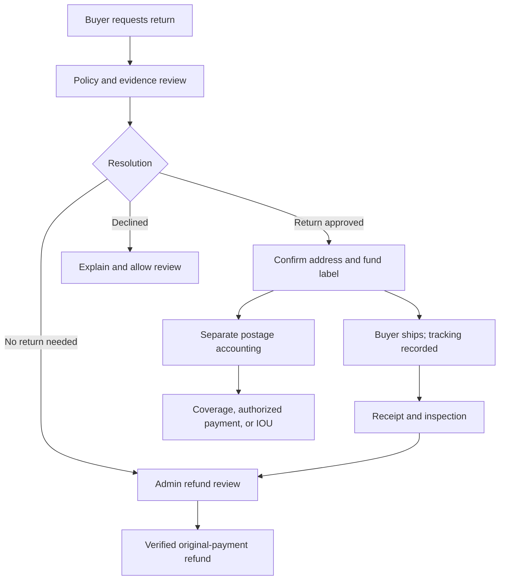

# KnifeRevive buyer returns: architecture and incremental Codex instructions

**October 28, 2026 · Design specification, not a live policy or deployment**

## 1. Product decision

Build a dedicated **KnifeRevive Returns** module integrated with existing Seller Orders, ShipKit, My Money/Money Moves, Connect, and the native buyer order page. Reuse the common financial ledger, private-document service, shipment evidence, and notification outbox. Do not create a second wallet, label-purchase engine, or refund executor.

The buyer starts from **My Account → Orders → Request a return**. An administrator authorizes the case and separately approves label spending. KnifeRevive purchases the label through WooCommerce Shipping, attaches it privately to the case, and exposes **Print Return Label**. The seller sees their own case, reason, notes, actual postage cost, tracking, and responsibility decision.

Keep three independent decisions:

1. **Return approval:** may the item be returned, and under which policy?
2. **Return-postage responsibility:** who ultimately pays the label and any correction?
3. **Buyer refund:** what money is owed back, when, and through which original payment?

Creating a label is not approving a refund. A carrier delivery scan is not proof that the returned contents match. An IOU is not an authorization to deduct money.

Continue from the supplied October 28 implementation baseline: ShipKit 0.5.1, Seller Orders 1.6.1, Connect 0.7.0, My Money 1.1.0, Dispatch 0.2.0; last audited Woo Shipping 2.4.3. Verify current source. Preserve the owner’s pause on new ShipKit payments; implement and test return-specific capabilities without silently enabling financial activity.

## 2. Etsy and Mercari research: lessons to adopt

Official primary sources were checked October 28, 2026. Use current Etsy policy effective July 9, 2026, not its archived predecessor.

| Platform | Verified pattern | KnifeRevive design judgment |
|---|---|---|
| Etsy | Listing-specific return policies; buyer contacts seller from the order; unresolved issues can escalate after 48 hours. [E1][E2] | Snapshot the sold policy and keep discussion/evidence attached to the order. Let admin intervene without forcing the buyer to restart. |
| Etsy | Agree return address, timing and shipping payer; receive the return, then refund. US sellers can provide a return label. [E3] | Make address, deadline, payer and expected refund explicit before label issuance. |
| Mercari | Return requests originate in the order; specified grounds include significant mismatch, damage and counterfeit. Requests generally have a 72-hour delivery-based window and pause completion. [M1] | Use a formal case with item scope and evidence. Do not copy the short window or rating-triggered closure into KnifeRevive automatically. |
| Mercari | Approved returns use prepaid labels; its policy specifies drop-off/scan deadlines and seller reporting of return problems. [M1] | Show one clear next action and deadline; use scan evidence without treating a missing scan as certain buyer noncompliance. |
| Mercari | Seller confirms a return address; buyers can recover the label from Order Status. [M2] | Confirm the destination and provide secure reprinting inside the buyer order. |

Mercari’s detailed policy and help summary describe deadline anchors somewhat differently. Do not reproduce that ambiguity: KnifeRevive must store one exact deadline origin and display the resulting date/time.

Do not import competitors’ automatic seller recoupment, forced account credits, or blanket payout rules. KnifeRevive’s Shipping IOU requires explicit seller payment authorization. Do not adopt a marketplace’s “no returns” exception list as a legal determination for KnifeRevive. Applicable consumer requirements and existing contractual policies need a reviewed configuration.

## 3. Scope and naming

Use clear buyer language; keep friendly labels in seller/admin areas.

| Surface | Name / action |
|---|---|
| Buyer order | Request a return; Return details; Print Return Label; Track return |
| Seller order | Returns; Return details; Respond to return |
| Seller accounting | Existing **Money Moves**, with a Return shipping filter |
| Admin | **Return Desk**, linked to Ship Desk |
| Seller label debt | **Shipping IOU**; Pay once; Use my balance; Ask for review |
| Seller relief | **Label Lifeline** |
| Approved flexible payment arrangement | **Shipping Game Plan** |

V1: domestic physical-item return cases, specific quantities, administrator-issued labels, full/partial refunds via supported original gateways, private evidence, and seller-visible postage accounting. Keep exchanges/replacements as linked manual resolutions initially; do not silently create replacement sales or implement exchange inventory as a side effect.

Non-delivery and pre-shipment cancellation are order-help cases, not requests to ship goods the buyer never received. Route them appropriately while preserving the initial report and its timestamp.

## 4. Policy snapshot and eligibility engine

Inspect actual listing return-policy storage. The ListLab report references `kr_return_policy` and category constraints; verify current implementation rather than hardcoding a policy taxonomy guess.

For new sales, persist an immutable per-item policy snapshot: policy ID/version and text/hash; seller-at-sale; return window and anchor; accepted reasons; item-condition requirements; postage responsibility; original-shipping/refund rules; exclusions; seller identity; jurisdiction/market scope where needed; checkout disclosure version. Save listing description/photos/condition references needed to evaluate “not as described.” Do not retain unnecessary personal data.

For old orders without a snapshot, use trustworthy purchase-time evidence if available. Current listing policy is not proof of the old agreement. Mark uncertain cases for admin review; do not auto-deny based on a changed policy or absent snapshot.

### Proposed responsibility matrix—not an activated policy

| Situation | Eligibility/resolution | Proposed return-postage responsibility |
|---|---|---|
| Wrong item, material undisclosed defect, significant mismatch | Admin evaluates sold listing and evidence | Seller if established under applicable policy; IOU or explicit payment authorization |
| Transit damage | Review packaging/carrier evidence; may require claim or refund without return | Determination after evidence; no automatic seller fault |
| Buyer changes mind / fit preference | Sold policy or separately agreed exception governs | Buyer if disclosed/agreed; otherwise seller/platform arrangement |
| Platform caused incorrect label/address | Correct the operational error | KnifeRevive |
| Unsafe damaged item | Stop ordinary return-shipping workflow; admin decides safe resolution | Explicit platform/policy decision; do not issue an unsafe label |
| Authenticity concern | Evidence/admin review; do not assume ordinary reshipment is appropriate | Determined, not defaulted from accusation |
| Seller refuses delivery / supplied invalid return address | Admin resolution; buyer not automatically penalized | Attribute after evidence |

Admin records `reason_claimed` separately from `finding` and `responsible_party`. A buyer’s selected reason does not establish fault.

For buyer-remorse postage, the module may still buy the label centrally. If buyer repayment or a refund deduction is allowed, require the disclosed policy and explicit amount agreement; otherwise KnifeRevive must approve coverage or seek a different resolution. Do not hide the postage deduction inside “refund fees.” Buyer funding, if later supported, uses a one-time flow; no carrier account is required.

## 5. Case creation and seller response

Buyer selects items and quantity, reason, desired resolution, notes, and appropriate evidence. Reuse the verified order owner; do not trust submitted buyer/seller IDs. Guest buyers need an order-claim/sign-in or verified email-link flow with short-lived single-use authorization. Order number plus email alone is not sufficient authorization to expose labels or mutate a return.

Partition a multi-seller order into seller-specific cases with a buyer-level overview. Distinct destinations require distinct parcels/labels. Quantities already in another active return or already refunded cannot be claimed again without an explicit reviewed correction. Lock item return allocation during case creation and edits.

Evidence should be proportional: photos for visible damage/mismatch, explanation and diagnostics where relevant, packaging photos for transit issues. Offer admin help when the buyer cannot supply a specific type of evidence. Never require recording a hazardous demonstration. Keep buyer-visible, seller-visible and admin-private notes separate; default buyer reason/notes to the seller-visible case log as requested.

Notify seller and admin when a case is filed. Seller can agree, propose a supported alternative, or provide evidence; admin retains final return and label authorization. Buyer can ask for help immediately. A response timer is an operational escalation, not a requirement to tolerate abuse or unsafe goods.

### Proposed operational deadlines, configurable before launch

- Return-request eligibility: purchase-time policy; missing evidence routes to review. Do not impose a new retroactive universal window.
- Seller response target: 48 hours from case notification; then escalate to admin, not auto-deny/auto-refund.
- Seller return-address confirmation target: 24 hours; unresolved address goes to admin.
- Buyer handover target: seven calendar days from label becoming accessible and notice being queued; pause/extend for replacement labels, outage or documented difficulty. Display exact deadline and contact path.
- Seller inspection target: two business days after confirmed delivery/receipt, with a configured business calendar; nonresponse escalates to admin review.
- Shipping IOU: proposed seven-day grace period, separate from all buyer-return deadlines.

Store deadline basis, timezone, version, extensions and audit reason. No automatic case denial solely because a scan is late, an email bounced, or the platform was unable to supply a working label. Do not make expiry of an operational reminder extinguish applicable rights.

## 6. State model: separate processes

| State machine | Typical states |
|---|---|
| Return case | submitted, awaiting_evidence, seller_response_due, admin_review, approved, declined, withdrawn, resolved |
| Label | not_needed, pending_address, quote_ready, spending_approved, purchasing, purchase_unknown, ready, void_requested, voided |
| Return shipment | awaiting_handover, buyer_reported_handover, carrier_accepted, in_transit, carrier_delivered, receipt_confirmed, exception, lost_review |
| Inspection | not_due, due, accepted, discrepancy_reported, admin_review, completed |
| Buyer refund | draft, approved, submitting, pending, succeeded, failed, unknown, canceled_before_submission |
| Seller postage | platform_covered, responsibility_pending, authorization_requested, iou_open, iou_disputed, payment_pending, paid, waived, credited |

Public status is a projection across these states. “Return approved—label being prepared” is different from “Return received—refund under review.” A dispute over postage cannot rewrite shipment evidence or buyer refund status.

## 7. Admin-issued Woo return labels

Woo documents native return-label support since 2.0.0. Its documented entry starts from a previously purchased outbound label, creating a return shipment with reversed addresses/items. [W1] This matters because KnifeRevive also permits externally purchased outbound labels: do not assume every order has the required Woo label or that a generic purchase method supports return direction.

### Adapter capability map

Extend existing ShipKit provider adapter with return-specific capabilities, not a second engine:

- `canQuoteReturn(scope)` / `quoteReturn(scope, parcel)`.
- `canCreateReturnForOutbound(provider_label_id)`.
- `canCreateStandaloneReturn(scope)`—false until verified.
- `submitReturn(purchase_command)` / `lookupReturn(correlation)`.
- Existing private document, refund/void, and reconciliation contracts with `direction=return`.

These are proposed internal interfaces, not claims about Woo function names. Inspect actual version-pinned Woo source and documented/supported extension points. Record method signatures, request/response schemas, authentication, permissions, order/fulfillment mutations, and async recovery. Never expose admin `wcshipping/v1` routes to buyers/sellers, impersonate a manager, or weaken upstream permission checks.

If native return generation requires an existing Woo outbound label and none exists, show an explicit operator exception. Use a proven supported standalone flow if available; otherwise document the provider limitation and use an approved external-label attachment path. Do not buy a dummy outbound label or create a fake sale to unlock returns. Do not silently switch providers.

### Address and parcel rules

Confirm buyer’s current return origin for this return. Confirm seller’s designated return destination, which may differ from historical outbound origin. Record who confirmed each and when. Address validation proves formatting/deliverability signals, not that a person has agreed to receive the parcel.

Never default all returns to KnifeRevive headquarters. Resolve seller-at-sale, actual fulfiller and return recipient explicitly for Dispatch. Do not let the buyer type an arbitrary destination or a seller reroute the parcel without admin review and a new label.

Prefill measurements only as suggestions; packed return dimensions/weight can differ. Preserve necessary customs/restricted-content declarations if later expanding beyond domestic scope. For damaged batteries, unsafe goods or sharp items needing special handling, require correct carrier eligibility/packaging review; do not instruct ordinary mailing when unsafe.

### Purchase protocol

1. Admin approves the return and confirms item quantities/destination.
2. Obtain actual service quote and evidence; show exact cost and no markup.
3. Record responsibility decision and platform spending authorization independently. A seller’s consent to pay is a separate record.
4. Reserve verified platform label capacity and create durable return-label attempt bound to case/scope/amount/currency/address/parcel/revision.
5. Purchase through official admin flow initially, or a verified programmatic bridge when supported. Record provider identity and authoritative amount/tracking; unknown outcome goes to reconciliation before retry.
6. Bind actual private label document to return parcel. Publish buyer/seller views and enqueue one label-ready notice.
7. Reprints retrieve the existing document. Replacements explicitly void/reconcile prior labels and preserve history.

The seller need not pay an IOU before an approved buyer return can proceed. If KnifeRevive chooses to issue first, it explicitly underwrites the cost and records seller responsibility where established. Do not pretend the receivable is cash or secretly reserve seller earnings. If budget is unavailable, escalate promptly with a visible operational problem and alternative resolution—do not leave the buyer in an unexplained queue.

## 8. Buyer and seller documents, tracking and telemetry

Buyer page: item, reason, approval, next step, destination summary, deadline, packaging instructions, **Print Return Label**, **Download**, **Track return**, and **Need help?** Email points to the authenticated page; private PDF attachment is unnecessary.

Seller page: buyer notes/evidence intended for seller, return address, carrier/service, original label cost, cost responsibility, IOU/payment/help actions, label availability, return tracking, inspection and refund-review state. Their own label may expose addresses needed for fulfillment; do not expose broader buyer account data or another seller’s returns.

Document authorization must check buyer order ownership, case seller/authorized recipient, or narrow admin capability on every request. Do not treat anonymous possession of an attachment ID as access. Prevent permanent public media URLs, shared caching, cross-case attachment reuse, and arbitrary server URL fetches. Screen evidence uploads by type/size/content and strip unnecessary image metadata; preserve original evidence privately where needed.

Telemetry definitions:

- **Label available:** valid document published to the case.
- **Downloaded:** authorized document response delivered; not proof the buyer read it.
- **Print opened:** print action invoked, only if recorded.
- **Printed:** do not claim this from browser `print()`/`afterprint`; neither proves physical printing.
- **Shipped:** distinguish buyer-reported drop-off from verified carrier acceptance.

Use verified provider/carrier events where available. Otherwise show tracking link and “Awaiting carrier update,” not fabricated real-time progress. Carrier delivery and seller inspection remain separate. Lost-in-transit or refused-delivery cases go to admin; buyer refund is not mechanically denied for seller noncooperation.

## 9. Refund adjudication, calculation and actual payment

The module prepares a refund proposal, but a label or return status must never directly execute it. Admin authorizes exact items/quantity, amounts, responsibility and funding under the current policy.

Inspection captures received quantities, condition, serial/identifier where relevant, missing components, and evidence. Disagreements create a review, not a unilateral seller deduction. For low-value/unsafe cases, admin may explicitly approve refund without physical return; record why and do not create an unnecessary label.

Compute from original paid allocation, not current product prices:

- Returned item amounts after allocated discounts.
- Appropriate original tax reversal using the existing gateway/Woo tax flow.
- Refundable original shipping and recorded fees under the policy.
- Prior completed/pending refund reservations and payment disputes.
- Any specifically authorized buyer return-postage contribution, visibly itemized, never disguised as a restocking fee.

Do not invent a new restocking policy. Default recommendation for established material seller fault: full affected-item refund plus applicable shipping/tax under reviewed policy, with no hidden return fee. Buyer-remorse rules follow the sold policy. Multi-item original shipping allocation requires an explicit deterministic rule; do not repeatedly refund a full shipping charge across partial returns.

### Gateway and Woo behavior

Resolve the actual charged transaction, which may belong to the parent order rather than a seller child order. Stripe Express is a seller transfer destination, not necessarily the buyer’s payment gateway. A PayPal purchase must use the appropriate PayPal refund path; do not send an unrelated Stripe payment and call it a refund.

Use one supported refund orchestrator around Woo/gateway integration. Woo distinguishes actual gateway refunds from manual refund records; changing order status alone does not move money. [W2] Do not both call the gateway directly and ask Woo to issue the same gateway refund. If reconciling a gateway-created refund into Woo, use the verified record-only path and durable external ID mapping.

Under a shared payment/refund lock, reserve the exact remaining refundable amount across all cases/sellers/refunds. Create immutable refund intent and idempotency/correlation before external submission. Release locks before network calls; retain durable claims. Unknown outcomes require lookup, not a second refund. Verify provider account, currency, payment identity and amount.

States must reflect reality: **Refund approved**, **Processing**, **Refund sent**, **Needs attention**. An insufficient-funded/pending provider refund is not cash delivered. Stripe documents reasons refunds can remain pending. [P1] Do not guarantee a bank arrival date from an order note.

Coordinate chargebacks and refunds to avoid double reimbursement. An external dispute opens a review path; neither silently refund twice nor tell the buyer they have no support. Store provider dispute status and enforce refund limits against authoritative payment evidence.

Restock only inspected, saleable returned quantity, once. Used/damaged items may need revised condition or a new listing; arrival is not authorization to relist as unchanged. A refund without return must not replenish inventory.

## 10. Return holds versus postage IOUs

Shipping IOUs must not freeze ordinary earnings, listings, sales, or store operation. Preserve this rule across UI, jobs and Connect.

A buyer return can have a different effect on the **original sale entitlement**, but only under an existing/approved return-refund policy. Design any return-review hold as case-specific, disclosed, limited to the affected unpaid amount, and independent of postage recovery. Do not automatically import Mercari’s transaction pause into KnifeRevive.

If the existing system has no authorized return-hold rule, default the new hold capability off and require an explicit policy decision. If enabled, it must coordinate with Connect’s same locks/claims and show “Order funds under return review,” never “Shipping IOU hold.” Unaffected seller earnings remain governed by normal payout rules.

On a completed buyer refund, reverse the original eligible sale entitlement through the existing canonical refund integration exactly once. This is refund accounting, not a new silent postage debit. If the seller’s funds already transferred, do not overwrite transfer receipts or automatically reverse Stripe transfers. Determine platform refund funding and seller product-refund recovery under the established refund agreement; if no mechanism exists, record a platform-funded exception and route to admin. Do not classify the entire product refund as a Shipping IOU.

The prior shipping-consent rules do not establish a universal product-refund recovery authorization. The implementation agent must map this gap rather than guessing.

## 11. Money Moves: use the common ledger

Extend the existing My Money activity/projection; do not introduce a second tab with conflicting totals or duplicate the original seller allocation.

Each return-related record needs return/case, order/item, seller, label/parcel, event identity, currency/amount, source, responsibility, state, timestamp, and linked reversal/credit.

| Event | Accounting / seller meaning |
|---|---|
| Platform buys $9 label, covers it | Platform expense/payable; seller sees $9 cost, $0 owed; no seller balance debit |
| Platform buys $9, seller responsibility established | Platform label obligation plus seller receivable; Shipping IOU $9, not a reduced available balance |
| Seller explicitly pays from eligible earnings | Reserve named sources against current case revision, apply $9 once; balance changes visibly |
| Seller pays once by card | Verified collection settles that receivable, not a new product sale |
| Carrier adds $3 | New linked assessment after responsibility review; separate IOU or newly authorized payment |
| Carrier refunds/credits label | Reduce outstanding incident debt first; restore collected contributions through their sources; no duplicate benefit |
| Platform waives unpaid IOU | Platform-funded relief clears debt; no additional withdrawable cash for an unpaid expense |
| Lifeline reimburses an actual paid loss | Platform-funded seller restitution payable, separate from sales, subject to normal payout requirements |
| Buyer product refund | Separate sale-refund accounting; never disguised as return postage |

Use shared source allocations and loss-recovery accounting from the latest ShipKit design. A platform-paid carrier refund is not automatically money owed to the seller if KnifeRevive bore that loss.

Statements must distinguish activity from balances: an expense, its IOU, its payment and its reversal are related views, not four independent costs. Export formal journal/event categories so summing visible snapshot rows does not double-count.

Keep the documented My Money correctness fixes in scope if still outstanding: authoritative standing-payout banner, server-provided balance label, managed-only/legacy scope, unavailable states and no invented bank-payout status.

## 12. IOU, Game Plan and relief rules

### Shipping IOU

Notice states reason, original label cost, new amount, responsibility determination, evidence, due date and review options. Actions: **Pay once**, **Authorize $X from eligible earnings**, **Ask for review**.

Every balance deduction binds exact amount, case revision, sources and one-use authorization. Old blanket consent does not authorize silent collection. Simultaneous card/balance payments reserve remaining debt to prevent duplicate collection. Never autocharge cards, banks, Express balances, current/future earnings or reserved buffers for a later IOU.

After the configured grace period, an overdue undisputed IOU may block new seller-initiated discounted label purchases. It must not block listings, sales, normal store operations, ordinary unrelated payouts, access to existing labels or buyer-return support. Admin can still underwrite a necessary buyer return under a separate spending decision; this prevents seller debt from trapping the buyer.

### Shipping Game Plan

Admin can approve a documented amount/due-date schedule and temporarily permit new labels within a separate exposure cap. No automatic installment debits: each payment is buyer/seller-initiated as appropriate or specifically authorized for that transaction. Record plan changes, reminders, partial payments and outcomes. Missed dates create admin review; do not trigger account-wide punishment. Keep reliability notes factual, limited-access and outside buyer-facing pages.

### Label Lifeline

Preserve the agreed automatic first qualifying honest label mistake up to $15, once per seller, for genuine unrecovered nonrefundable loss. Amount above $15, repeat/unclear cases require review. Attempt an eligible carrier refund first; pending refund is not final denial. A normal return or routine seller-fault refund is not automatically an honest label mistake.

Finalized reimbursement for money actually spent becomes a platform-funded withdrawable seller payable, not shipping-only credit. If the cost is unpaid, waive the corresponding IOU instead of paying cash as well. Use atomic entitlement/budget claims and the established same-loss recovery map; later carrier reimbursement must not produce double recovery or claw back unrelated funds automatically.

**First seller return label free** is a separate disabled policy proposal. Store independent eligibility, lifetime/order scope, cap, budget, policy version and benefit consumption. Do not consume the $15 mistake entitlement merely because this separate return benefit covers a label. Conversely, one label cannot receive duplicate full benefits. Require explicit policy configuration before enabling it.

## 13. Proposed software boundaries

New plugin: `kniferevive-returns`, unless the repository already has a suitable return-case module. It owns cases and decisions, not money execution.

| Component | Responsibility |
|---|---|
| `ReturnPolicyResolver` | Sold policy snapshots, eligibility/review reasons, deadline calculations |
| `ReturnCaseService` | Item scope, evidence, conversation, state transitions, admin decisions |
| `ReturnLabelCoordinator` | Calls ShipKit with return direction and platform spending authorization |
| `ReturnTrackingProjection` | Incoming return parcels; never marks outbound seller fulfillment anew |
| `ReturnInspectionService` | Receipt, item condition, disputes and restock decision |
| `ReturnRefundCoordinator` | Exact refund proposal/approval and existing Woo/gateway executor |
| ShipKit ledger / IOU / Lifeline | Postage, funding, liability, explicit recovery and relief |
| Connect common payable | Authorized sale-refund effects, holds if applicable, safe claims/slices |
| My Money | Shared return-related projection and Money Moves |

Suggested case entities: `return_case`, `return_items`, `policy_snapshot`, `case_events`, `case_evidence`, `return_parcels`, `label_links`, `responsibility_decisions`, `refund_intents`, `inspection`, `deadline_events`. Reuse existing financial tables and document/outbox systems. Use real table prefixes, versioned migrations, transactional claims and immutable posted evidence.

Important unique constraints: active item-quantity allocation, provider label identity per account/environment, refund intent economic key, external refund mapping, IOU economic key, notification event, Lifeline benefit claim. Use quantities rather than a crude “one return per order” flag, allowing legitimate partial cases without exceeding purchased quantity.

### API proposals, not existing routes

- Buyer: create/list/read case, add evidence/message, withdraw before irreversible steps, access label, report handover, request help.
- Seller: own case response/address confirmation, inspection, own postage views, explicit IOU authorization/review.
- Admin: approve/decline, set responsibility, approve spending, issue/bind/void label, resolve inspection, approve refund, review relief.
- Worker: verified events and internal reconciliation; no unauthenticated generic “mark refunded” route.

Use session authentication/nonces and per-case authorization; derive identities server-side. Core My Money stays GET-only. Route registration occurs on `rest_api_init`. Protect HPOS compatibility through Woo CRUD; do not update order status by direct SQL or write unknown tracking meta hoping every view understands it.

## 14. Operations, failure handling and limits

Return Desk queues: **Needs review**, **Confirm address**, **Label to issue**, **Awaiting buyer shipment**, **Inspection due**, **Refund pending**, **Needs help**. Ship Desk retains label purchase/provider exceptions; link the same case instead of copying uncoordinated tasks.

Use durable outbox/inbox jobs for notices, carrier events, PDF binding, refund reconciliation and deadlines. Each has an owner, retry budget, next-review time and escalation. Notifications are not proof of payment, delivery, reading, or physical printing.

Keep these failures distinct:

- Label purchased, attachment/projection failed: repair the same label.
- Provider response unknown: reconcile; no duplicate label or refund.
- Label unreadable/voided: notify buyer, replace safely, extend deadline.
- Seller refuses/does not confirm address: admin resolves, not automatic buyer denial.
- Return lost or delivered to disputed address: evidence review and claim; no automatic claim approval.
- Refund pending due to platform funding: financial exception with buyer update, not “refunded.”
- Unavailable ledger: no unsafe money mutation or fallback to unadjusted seller balance.

Budget return labels separately within approved platform capacity. The prior $100 postage limit is not automatically a new return-protection guarantee or Lifeline budget. No first-return-free promise until funded/configured.

Return feature kill switches must preserve existing case access, documents, evidence, valid refunds and reconciliation. Separate disabling new requests, label issuance and automated workers; a safety pause should not strand already-approved buyers without support.

## 15. Incremental build plan

**A — Discover and preserve.** Audit current return plugins, order policy snapshots, refund writers/gateways, ShipKit APIs and actual Connect refund semantics. Document supported/unsupported cases and policy gaps. No new competing ledger or payout engine.

**B — Case workflow.** Build buyer/seller/admin private case screens, policy snapshots, item allocations, evidence, decisions, deadlines and notifications. No money movement yet. Show proposals vs configured policy clearly.

**C — Return-label integration.** Add return direction and provider mapping; administrator issuance and private Print Return Label. Test native-return prerequisite and external-outbound fallback. Keep uncertain automated Woo capabilities disabled while assisted attachment works.

**D — Responsibility and accounting.** Integrate Money Moves, explicit IOU payment, Game Plan, same-loss credits and separate relief policies. Prove buyer progress is not dependent on collecting a seller IOU.

**E — Refund execution.** Implement actual parent-payment mapping, item/tax/shipping allocation, refund intent locks, supported gateway orchestration, canonical refund/entitlement projection, and restock decisions. Configure any return-review hold separately from IOUs.

**F — Controlled pilot.** Genuine gateway test-mode payment/refunds; authorized real label/void/refund exercises; real private buyer/seller sessions; intended notification delivery. Existing owner pauses remain until explicitly changed. Do not send support messages, accept carrier terms or make paid transactions solely because this document describes them.

## 16. Acceptance matrix

1. Buyer can return one quantity from a multi-item/multi-seller order without accessing another seller’s case or exceeding purchased quantity.
2. Missing/changed historical policy routes to review instead of silently applying today’s rule.
3. Seller sees buyer reason/notes, label cost, responsibility and progress; admin-private notes remain private.
4. Both account and verified guest order-access paths resist guessed IDs/replayed tokens.
5. Confirmed buyer origin/seller destination are used; parent order and Dispatch do not misroute returns.
6. Native Woo outbound-linked return works where supported; external-outbound case does not create a dummy sale/label.
7. One admin purchase yields one label despite retries; private download/reprint never purchases again.
8. Download/print-dialog events never become “physically printed”; missing scans do not fabricate transit/delivery.
9. $9 platform-covered label shows $0 seller owed. Seller-responsible $9 creates IOU with unchanged earnings until exact authorization.
10. Overdue IOU cannot block listings, sales, unrelated payouts or admin-supported buyer return processing.
11. Game Plan extends only its recorded terms, with no automatic installments.
12. First-return-free stays disabled; first honest mistake ≤$15 and repeat/large cases follow separate rules.
13. Later carrier credit after IOU payment/Lifeline settles the same loss exactly once, with no double benefit.
14. Label issuance and carrier delivery cannot independently trigger a buyer refund.
15. Concurrent partial refunds/returns/chargebacks on one parent payment cannot exceed remaining captured amount.
16. PayPal buyer refund does not mistakenly use a seller’s Stripe Express transfer rail.
17. Manual Woo refund record/status does not claim money was returned; pending/unknown gateway results reconcile safely.
18. Return sale-entitlement changes cannot be mistaken for shipping IOU setoff; already-transferred history stays immutable.
19. Seller nonresponse, unsafe goods, lost/refused return, late scan and unavailable label have explicit admin resolution paths.
20. Inventory restocks only inspected saleable quantity once; refund-without-return does not create stock.
21. HPOS on/off; real application-class races; mobile 320px/390px; keyboard/focus; private-file HTTP checks and cross-seller denial.
22. Tests identify mock/provider-test/live evidence separately; cumulative suites are not unique-test counts.

Deliver coordinated source/package changes, schema migrations, policy configuration preview, provider capability map, refund/gateway authority map, seller/buyer screenshots using fixtures, test evidence, incident/reconciliation runbook and completion report. A complete UI without a verified refund/label path must be reported as incomplete integration.

## Primary references

Checked October 28, 2026. Marketplace rules are examples, not KnifeRevive policies. The proposed deadlines and responsibility matrix require approval/configuration and applicable policy review.

- **E1:** Etsy current Cases Policy, effective July 9, 2026: https://www.etsy.com/uk/legal/policy/cases-policy/243306189901
- **E2:** Etsy returns/exchanges and listing policies: https://help.etsy.com/hc/en-us/articles/115015440807-How-to-Return-or-Exchange-an-Item-on-Etsy
- **E3:** Etsy seller return coordination: https://help.etsy.com/hc/en-us/articles/360022953514-How-to-Help-a-Buyer-With-a-Return
- **M1:** Mercari Refunds and Returns: https://www.mercari.com/us/help_center/topics/account/policies/refunds-and-returns/
- **M2:** Mercari shipping labels and return-address/download guidance: https://www.mercari.com/us/help_center/article/6000/
- **W1:** WooCommerce Shipping, Return labels: https://woocommerce.com/document/woocommerce-shipping/
- **W2:** WooCommerce actual versus manual refunds: https://woocommerce.com/document/woocommerce-refunds/
- **P1:** Stripe pending refunds: https://support.stripe.com/questions/fix-your-pending-refund

Inputs: user-provided buyer-return brainstorming and the already-reviewed October 28 ShipKit/My Money reports. This handoff does not claim a fresh live source audit, production change, paid transaction, refund, or notification delivery.
